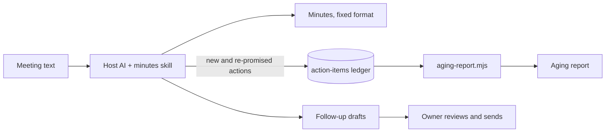

# Minutes & Actions

An AI skill kit that turns meeting text into minutes in one fixed format, an
action-items ledger that compounds across meetings, an aging report, and
follow-up email drafts.

> Portfolio piece. Source shown for review only; not licensed for use. See LICENSE.

## What it does

The owner drops in the text of a meeting (a transcript, or a voice memo already
turned into text) and gets back, the same way every time:

1. Minutes in one fixed format.
2. An append-only action-items ledger: owner, action, due date, status, and how
   many meetings the same commitment has been raised in.
3. An aging report over that ledger: overdue, aging and on-track items, who is
   carrying the most, and anything re-promised three or more times without
   closing. It can be asked for any day, with no new meeting.
4. Follow-up email drafts in the owner's own voice, for the owner to send.

## The problem

Meeting notes are written in a different shape every time, and the commitments
in them are forgotten by the next meeting. A plain chat session can summarise
one meeting, but it cannot say that the same item has been promised in four
straight meetings, because it has no memory of the previous three. A commitment
that keeps slipping is usually blocked or sitting with someone who does not
control what it depends on, and nobody sees the pattern.

## How it works

The kit is a folder of markdown: a self-adapting `installer.md` that any host AI
reads to install the kit for its own platform, and a `minutes` skill with four
workflows (take minutes, update ledger, aging report, draft follow-ups), a voice
file, and an empty starter ledger. The AI writes the minutes and the
plain-language read-back. A re-promise increments `Times Raised` on the existing
ledger row instead of adding a duplicate. The aging report's date parsing, day
counts, bucket sorting, owner totals and repeat set are computed by one
dependency-free Node script, `skills/minutes/scripts/aging-report.mjs`, so the
same ledger on the same date gives the same answer. In a chat with no code
execution the kit runs from the same rules and labels the report as
self-checked, not script-verified.



## Features

- One minutes skeleton, so no section is forgotten and every meeting reads the
  same.
- Ledger rows are only added or have their status and counts updated; history is
  never rewritten. Handoffs keep one row and move the owner.
- Repeat flag for anything raised three or more times without closing, framed as
  "what's in the way of this?", never as a case against a person.
- Refusal gate: if the meeting text yields fewer than two trackable things
  (owned actions, decisions and loose ends combined), the kit says so and waits.
  The owner can go ahead, and every gap goes to a Parking Lot. The gate is asked
  once per meeting type, so a daily huddle can be quieted.
- Never invents a name, date or owner the text does not support.
- Transcript text is treated as data; instructions inside it are not followed.
- Follow-up emails are drafted only; the owner sends them.
- Three complete worked examples in `examples/`, including a refusal.

## Stack

- Markdown skills and workflows, readable by any AI host
- Plain Node 22.6+ (`.mjs`, no packages, no build step) for the aging engine
- `node:test` suite in `tests/` and a package verifier in `scripts/verify-kit.mjs`

## Status

Experimental. Current: **1.1.4 (2026-08-17)**. Install verified in the Claude app and Codex on
2026-08-12; claude.ai web install not tested. The v1.1.1 additions (aging report,
refusal gate, own-data install check, examples) have not been re-run in a clean
room. `tests/` passes (7 tests) and `scripts/verify-kit.mjs` passes.

## Repository layout

- `installer.md`, `START-HERE.md` — the self-adapting installer
- `OPERATIONS-MANUAL.md` — plain-language operating guide
- `skills/minutes/` — the skill, workflows, voice file, ledger and aging script
- `examples/` — three complete worked runs
- `tests/`, `scripts/verify-kit.mjs` — aging engine tests and package verifier
- `tiers/` — tier notes

## Running it locally (for reviewers)

```sh
node --test tests/*.test.mjs
node scripts/verify-kit.mjs
```

## Screenshots

None.

## Author

Rico Rojas, rico@rtech-consulting.com, https://rico-rojas.com
