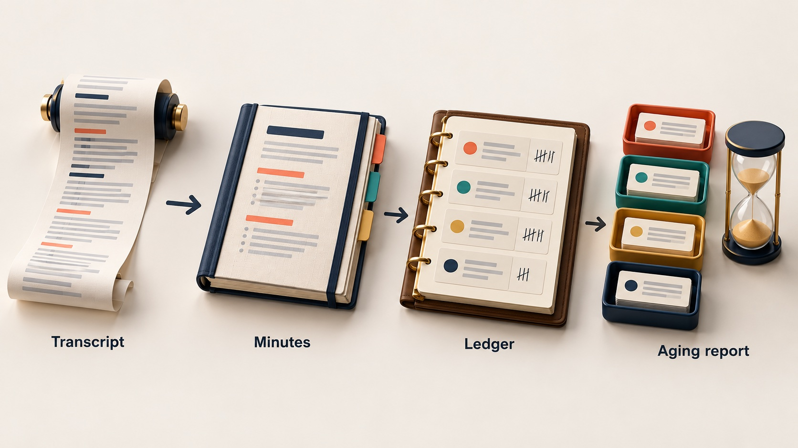
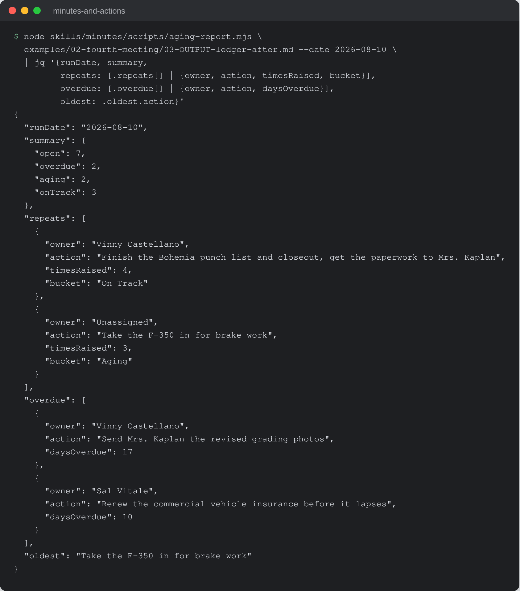

# Minutes & Actions

Turn meeting text into consistent minutes, a running action-items ledger, an
aging report and follow-up email drafts, so nothing promised in a meeting is
lost by the next one.


-f7df1e)


## What it is

An AI skill kit: a folder of markdown that any capable AI assistant (Claude,
Codex and similar hosts) reads and installs for its own platform, plus one
dependency-free Node script that does the date and ledger arithmetic. The owner
pastes the text of a meeting (a transcript, or a voice memo already turned into
text) and gets back, the same way every time:

1. Minutes in one fixed format.
2. An append-only action-items ledger: owner, action, due date, status, and how
   many meetings the same commitment has been raised in.
3. An aging report over that ledger: overdue, aging and on-track items, who is
   carrying the most, and anything re-promised three or more times without
   closing. It can be asked for on any day, with no new meeting.
4. Follow-up email drafts in the owner's own voice, for the owner to send.

## Why it exists

Meeting notes are written in a different shape every time, and the commitments
in them are forgotten by the next meeting. A plain chat session can summarise
one meeting, but it cannot say that the same item has now been promised in four
straight meetings, because it has no memory of the previous three. A commitment
that keeps slipping is usually blocked, or sitting with someone who does not
control what it depends on, and nobody sees the pattern. This kit keeps that
record so the team can spend the meeting on the work, not on reconstructing who
said what.

## How it works



`installer.md` is a self-adapting installer: the host AI reads it and installs
the `minutes` skill in the form its platform supports. The skill routes each
request to one of four workflows: take minutes, update the ledger, run the aging
report, or draft follow-ups. The AI writes the minutes and the plain-language
read-back; a re-promise increments `Times Raised` on the existing ledger row
instead of adding a duplicate. Date parsing, day counts, bucketing, owner totals
and the repeat set are computed by `skills/minutes/scripts/aging-report.mjs`, so
the same ledger on the same date always gives the same answer. In a chat with
no code execution the kit applies the same rules by hand and labels the report
as self-checked, not script-verified.

## Features

- One minutes skeleton, so no section is forgotten and every meeting reads the
  same.
- Ledger rows are only added or have their status and counts updated; history
  is never rewritten. A handoff keeps one row and moves the owner.
- Repeat flag for anything raised three or more times without closing, framed
  as "what's in the way of this?", never as a case against a person.
- Refusal gate: if the meeting text yields fewer than two trackable things
  (owned actions, decisions and loose ends combined), the kit says so and
  waits. The owner can go ahead anyway, and every gap goes to a Parking Lot.
- Never invents a name, date or owner the text does not support.
- Transcript text is treated as data; instructions found inside it are quoted
  back to the owner, not followed.
- Follow-up emails are drafted only. The owner reads, edits and sends them.
- Three complete worked examples in `examples/`, including a refusal.

## Run it locally (for review)

Requires Node 22.6 or newer. No packages, no build step.

```sh
git clone https://github.com/rodaddy/minutes-and-actions.git
cd minutes-and-actions

# Unit tests for the aging engine, and the package verifier
node --test tests/*.test.mjs
node scripts/verify-kit.mjs

# Run the aging engine on the worked example's ledger
node skills/minutes/scripts/aging-report.mjs \
  examples/02-fourth-meeting/03-OUTPUT-ledger-after.md --date 2026-08-10
```



*The last command above on the four-meeting example ledger, with its JSON
trimmed by `jq` to the summary, repeats and overdue items. The counts match the
aging report in `examples/02-fourth-meeting/04-OUTPUT-aging-report.md`.*

To use the kit itself, open `START-HERE.md` in your AI assistant and follow the
installer. `OPERATIONS-MANUAL.md` is the plain-language operating guide.

**Licence:** free for personal and non-commercial use with credit; commercial
use needs a licence. See [LICENSE](LICENSE) (PolyForm Noncommercial 1.0.0) or
contact rico@rtech-consulting.com.

## Repository layout

- `installer.md`, `START-HERE.md`: the self-adapting installer
- `OPERATIONS-MANUAL.md`: plain-language operating guide
- `skills/minutes/`: the skill, workflows, voice file, ledger and aging script
- `examples/`: three complete worked runs
- `tests/`, `scripts/verify-kit.mjs`: aging engine tests and package verifier
- `tiers/`: tier notes
- `docs/images/`: README images

## Project status

Experimental. Current: **1.1.4** (2026-08-17). The install has been checked in the Claude app and
in Codex; the claude.ai web install has not been tested. The aging report,
refusal gate and examples added in 1.1.1 have not been re-run in a clean
environment. The test suite (7 tests) and the package verifier pass.

## Credits

Built on plain Node.js (`node:test`, `node:fs`) with no third-party packages.

## Author

Rico Rojas, https://rico-rojas.com
